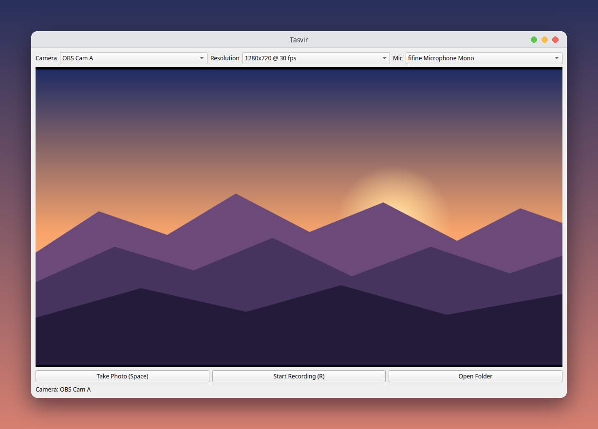
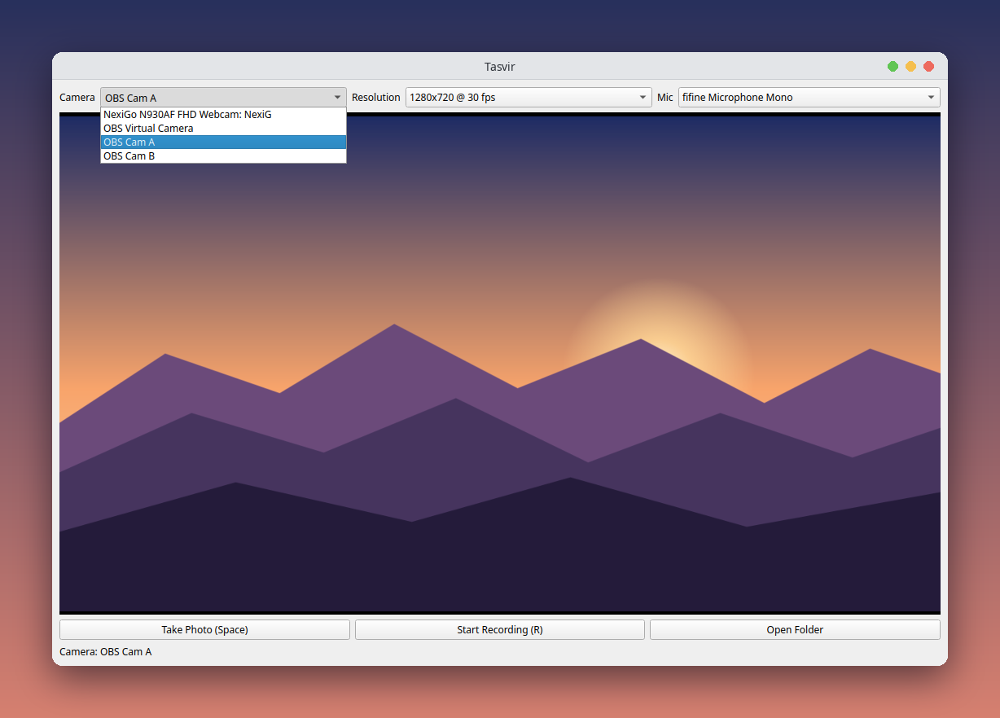
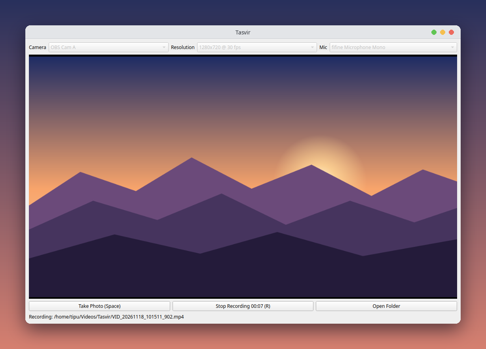

<div align="center">

# Tasvir

**A small, no-fuss camera app for the Linux desktop.**

Pick a camera, take a photo, record a video with sound. Files land in your Pictures and Videos folders.


-41cd52)




</div>

*Tasvir* (تصویر) means "picture" in Urdu and Persian.

## Features

- **Live preview** from any V4L2 camera: USB webcams, built-in cameras and virtual cameras such as OBS.
- **Camera switching** from a drop-down. Cameras that you plug in or remove show up on their own.
- **Resolution picker.** Tasvir starts with the largest mode the camera offers.
- **Photos** as JPEG with one key press.
- **Videos** as MP4 with AAC audio from the microphone you pick, or with no audio.
- **Hardware H.264** when a working encoder exists, with an automatic software fallback.
- **One Python file** on top of the PySide6 wheels. No distribution Qt or GStreamer packages needed.

| Switch cameras | Record video |
| --- | --- |
|  |  |

The preview in these screenshots is a generated test image, not a camera feed.

## Install

```bash
git clone https://github.com/tipu/tasvir.git
cd tasvir
./install.sh
```

Start **Tasvir** from the application menu, or run `tasvir`.

The installer needs `python3` 3.10 or newer with the `venv` module. It does these steps:

1. It checks Python, glibc and the system libraries that the camera backend links against. It stops with a clear message when one is missing.
2. It creates a virtual environment in `~/.local/share/tasvir` and installs PySide6 into it.
3. It adds the `tasvir` command to `~/.local/bin`.
4. It adds a menu entry.

Remove Tasvir with `./install.sh --uninstall`. Your photos and videos stay in place.

### Requirements

| | |
| --- | --- |
| CPU and C library | x86_64 with glibc 2.34 or newer, or aarch64 with glibc 2.39 or newer |
| Distributions | Ubuntu 22.04+, Debian 12+, Fedora 35+, RHEL 9+, Arch |
| Python | 3.10 or newer, with `venv` |
| Display | X11 or Wayland. On X11 Qt also needs `libxcb-cursor0` (Fedora and Arch: `xcb-util-cursor`). |
| Audio | PulseAudio or PipeWire |

The glibc limits come from the PySide6 6.12 wheels.

## Use

| Control | Action |
| --- | --- |
| Camera list | Switch camera. |
| Resolution list | Pick a camera mode. |
| Mic list | Pick a microphone, or `No audio`. |
| **Take Photo** or <kbd>Space</kbd> | Save a JPEG. |
| **Start Recording** or <kbd>R</kbd> | Start or stop a video. Camera and mic switching lock while a video records. |
| **Open Folder** | Open the save folder in the file manager. |

Files save here:

| Kind | Path |
| --- | --- |
| Photos | `~/Pictures/Tasvir/IMG_<timestamp>.jpg` |
| Videos | `~/Videos/Tasvir/VID_<timestamp>.mp4` |

The folders follow your XDG user directories, so a localized `Pictures` or `Videos` folder works too.

Command-line options:

```bash
tasvir --camera "Cam A"          # start with the first camera whose name contains "Cam A"
tasvir --output ~/Desktop/shots  # save photos and videos in one other folder
```

## How it works

Tasvir is one Python file, `tasvir.py`, on top of the PySide6 (Qt 6) wheels from PyPI. Those wheels bundle Qt and an FFmpeg build. So Tasvir does not depend on the Qt or GStreamer packages of your distribution.

```
camera (V4L2) ──┐
                ├──> Qt Multimedia capture session ──> preview widget
mic (PipeWire) ─┘                │
                                 ├──> image capture ──> JPEG
                                 └──> recorder (FFmpeg) ──> MP4 (H.264 or MPEG-4 + AAC)
```

Video uses H.264 when a working hardware encoder exists. When H.264 fails to start, Tasvir retries with MPEG-4 Part 2, which the bundled FFmpeg always encodes in software. VLC, mpv and the KDE players play both. Web browsers play only the H.264 files.

## Troubleshooting

| Symptom | Cause and fix |
| --- | --- |
| The preview stays black and the status line says the camera gives no video. | Another program (for example OBS or a video call) holds the camera. Close it, or pick another camera. |
| "Qt Multimedia could not load its FFmpeg backend" | A system library is missing. Run `QT_DEBUG_PLUGINS=1 tasvir` to see which one, then run `./install.sh` again. |
| The window does not open on X11. | Install `libxcb-cursor0` (Fedora and Arch: `xcb-util-cursor`). |

## Development

```bash
python3 -m venv .venv
.venv/bin/pip install -r requirements.txt
.venv/bin/python tasvir.py
```

Headless self-test. It takes a photo and a 3 second video from each camera, checks the files and exits non-zero on any failure:

```bash
QT_QPA_PLATFORM=offscreen .venv/bin/python tasvir.py --selftest --output /tmp/tasvir-test
```

GUI smoke test. It opens the real window, switches through the cameras, clicks **Take Photo** and presses <kbd>R</kbd> twice for each one:

```bash
.venv/bin/python tests/smoke_gui.py --cameras "Cam A,Cam B" --output /tmp/tasvir-gui
```

## License

[MIT](LICENSE)
